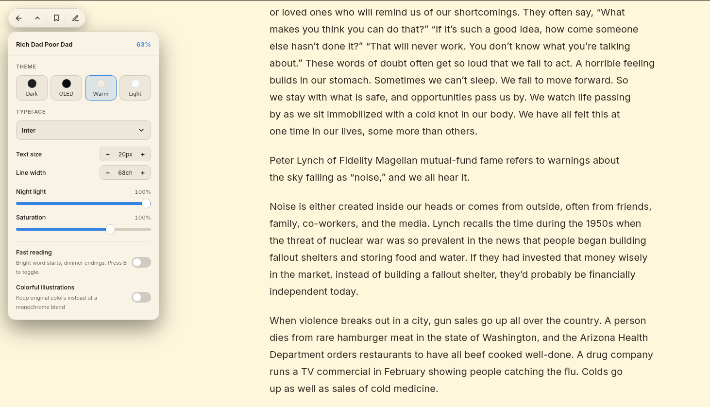
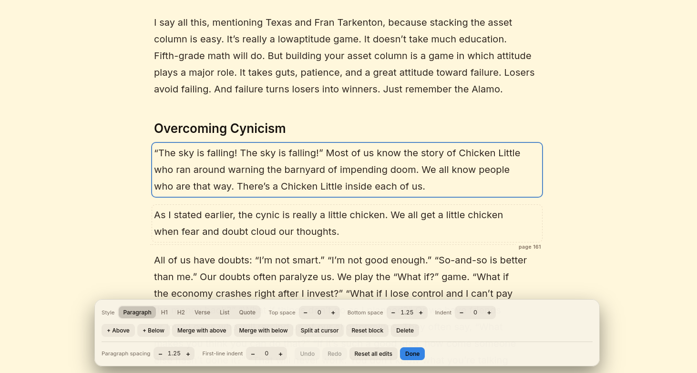
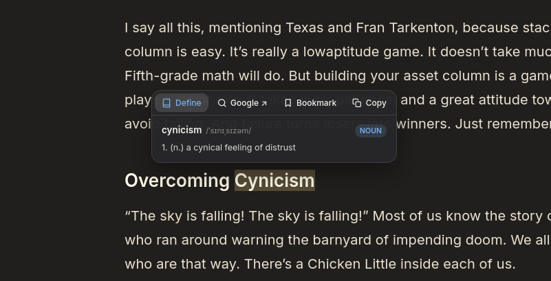
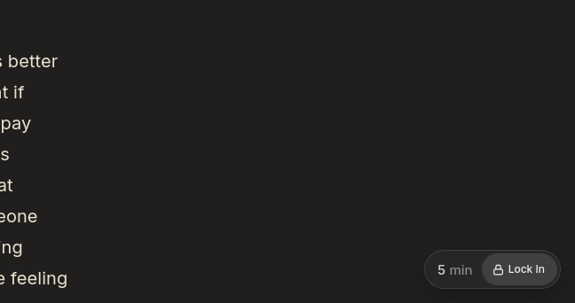

<div align="center">


# Readit

**Read books the way they deserve to be read.**

A native GNOME reader that turns PDF books into a calm, continuous vertical page.

[Overview](#overview) · [Features](#features) · [Install](#installation) · [Getting started](#getting-started) · [Privacy](#privacy)

</div>

---

## Overview

Readit is a book reader for Linux, built for GNOME with GTK 4 and libadwaita. Import a PDF and Readit reshapes its text and illustrations into one uninterrupted vertical stream: no page borders, no toolbars in your way, nothing between you and the words.

The interface stays out of sight until you reach for it. Controls fade in when your pointer visits a screen corner and disappear when you move on, so what remains on screen is the book.

> **A note on PDFs.** Readit works with PDFs that contain selectable text. Scanned PDFs without a text layer may not produce readable content.

## Features

- **Reflowed reading.** PDF text and illustrations become a continuous vertical view.
- **Your own look.** Four themes, six typefaces, and adjustable text size, line width, night-light warmth and saturation.
- **Library and progress.** Your books live in one library, and Readit remembers where you stopped.
- **Bookmarks.** Save passages and return to them from a dedicated panel.
- **In-place editing.** Correct extracted text and adjust paragraph spacing and indent right in the reader.
- **Word lookup.** Select text to look it up with the bundled dictionary, with online fallbacks.
- **Fast reading.** Optional emphasis on word beginnings, in three strengths.
- **Lock In.** Timed full-screen focus sessions that take away your exits.

---

## Showcase

### Make it yours

Choose from four themes (**GNOME Dark**, **OLED Black**, **Warm Paper** and **Crisp Light**) and six typefaces (**Literata**, **IBM Plex Serif**, **EB Garamond**, **Atkinson Hyperlegible**, **Inter** and **JetBrains Mono**). Fine-tune text size, line width, warmth and saturation until the page feels right for the hour and the room.



*Themes, typefaces and light controls, all from one panel.*

### Fix the page, not just read it

PDF extraction is rarely perfect. Edit mode lets you correct text in place and tune paragraph spacing and indent, so the book reads the way you want it to.



*Editing extracted text and layout directly in the reading view.*

### Look it up without leaving the page

Select a word or phrase to open a small card with a definition. The bundled dictionary is tried first. If it has no entry, Readit can fall back to an online dictionary or a short contextual explanation, both of which need an internet connection.



*Selecting text to define it in place.*

### Lock In

Set a duration, press **Lock In**, and Readit goes full screen for that long. While the timer runs, going back to the library, closing the app and leaving full screen are disabled. Your reading controls keep working. Hover the bottom-right corner at any time to see the time remaining.



*Choose minutes, lock in, and read.*

> Lock In is an in-app focus aid. It keeps Readit itself from being closed or exited, but it does not control your desktop environment.

### Keep your place

Bookmark the passages you want to come back to and revisit them from the bookmarks panel. Readit also saves your reading position and progress automatically.


*Bookmarks collected in one panel.*

### Fast reading

Fast reading brightens the start of each word and softens the rest, which can help your eyes move along the line. Choose **Subtle**, **Balanced** or **Strong**, and press **B** to switch it on or off while you read.

---

## Installation

Readit targets **Linux with GNOME**.

### Requirements

- Python 3
- GTK 4
- libadwaita
- WebKitGTK 6
- PyGObject
- PyMuPDF

Install these with your distribution's package manager. Package names differ between distributions, so check your distribution's package index for the libraries above.

### Install for your user

From the project directory:

```bash
./install.sh
```

This installs Readit under `~/.local/share/readit-app` and creates a `readit` launcher in `~/.local/bin`. Make sure `~/.local/bin` is on your `PATH`, then start it with:

```bash
readit
```

### Run from source

After installing the requirements above, from the project directory:

```bash
python3 main.py
```

### Arch Linux

The repository includes a `PKGBUILD`. Build and install it with:

```bash
makepkg -si
```

---

## Getting started

1. Launch Readit.
2. Choose **Import PDF Book** and open a text-based PDF.
3. Open the book from your library.
4. Move your pointer to the top-left corner for reading options such as theme, typeface and size.
5. Select any text to look it up, bookmark it or copy it.
6. When you want to stay put, hover the bottom-right corner, pick a duration and press **Lock In**.

### Shortcuts

| Key | Action |
| --- | --- |
| `B` | Toggle fast reading |
| `M` | Maximize or restore the window |
| `F11` | Toggle full screen |

---

## Privacy

Readit keeps your library, reading progress, bookmarks and settings on your machine, under `~/.local/share/readit`.

Reading, editing and the bundled dictionary work offline. Some lookups can contact the internet, and you should know what is sent:

- **Online dictionary.** If the bundled dictionary has no entry for a word, the word is sent to the online dictionary service [dictionaryapi.dev](https://dictionaryapi.dev).
- **Contextual explanation.** If that fails or the selection is longer than a single word, the selected text and a short excerpt of the surrounding passage are sent to [pollinations.ai](https://pollinations.ai) to generate an explanation.
- **Google search.** Choosing **Google** opens your browser with the selected text as the search query.

Nothing is sent unless you select text and ask for a lookup.

---

## Help and contributing

Found a bug, or have an idea? Please open an issue on the project's issue tracker with what you expected, what happened, and your GNOME version. Pull requests are welcome; for larger changes, open an issue first so we can talk it through.